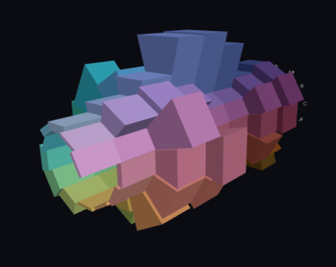

# Cochlea

Experimental audio visualization tool.



## Objective

Show musical notes as a helix, one turn per octave.


## Install

Needs Python 3.10+. Node is optional, for the page's parser test.

Mac:

```
git clone https://github.com/klahnakoski/cochlea.git
cd cochlea
python3 -m venv .venv
source .venv/bin/activate
pip install -e '.[dev]'
```

Windows (PowerShell):

```
git clone https://github.com/klahnakoski/cochlea.git
cd cochlea
python -m venv .venv
.venv\Scripts\Activate.ps1
pip install -e .[dev]
```

## Run

With the venv active, on either platform:

```
python -m cochlea
```

Open http://localhost:5000 and choose an audio file.

## Test

With the venv active, from the repo root:

```
python -m pytest
node web/frames.test.mjs
```
